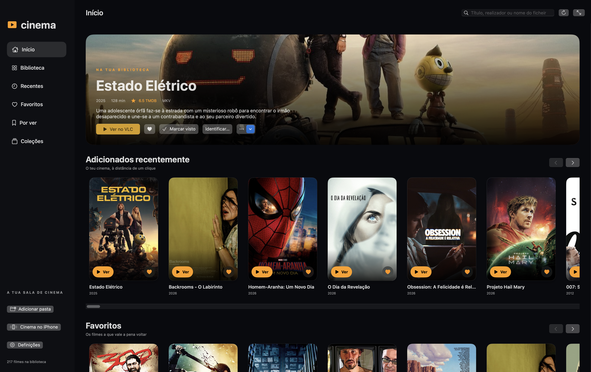

# Cinema

**[Português](#português) · [English](#english)**

## Português

**Os teus filmes. A tua sala. No Mac, iPhone e iPad.**

Projeto comunitário de Patrício Brito ([Pathink1973](https://github.com/Pathink1973)), criado com ajuda do Codex. Transforma as tuas pastas de vídeos numa biblioteca pessoal com capas, fichas de filmes, favoritos e coleções. Código aberto para aprender, adaptar e criar a tua própria versão.

**Desktop:** aplicação nativa para macOS, em SwiftUI. **Mobile:** web app que o Mac disponibiliza na mesma rede Wi-Fi; abre no Safari e reproduz os vídeos no VLC instalado no iPhone/iPad. Não é uma aplicação da App Store nem um serviço na cloud. A captura acima mostra a interface; filmes e respetivas imagens não estão incluídos no projeto.

### Antes de começar: obter o token TMDB

O [TMDB — The Movie Database](https://www.themoviedb.org) fornece as capas, sinopses, elenco, realização e outros metadados. **Cada pessoa usa a sua própria conta e o seu próprio token.** Sem token, podes organizar a biblioteca e reproduzir os teus ficheiros locais; a pesquisa de novos dados no TMDB exige o token.

1. Pelo browser do computador, cria uma conta ou inicia sessão no [TMDB](https://www.themoviedb.org).
2. Abre **Definições da conta → API**, ou acede diretamente a [themoviedb.org/settings/api](https://www.themoviedb.org/settings/api).
3. Se ainda não tens acesso, inicia o pedido de API para desenvolvimento/utilização pessoal. Lê os termos e preenche os dados reais pedidos pelo TMDB. Os nomes e a disposição dos campos podem mudar.
4. Nos dados da aplicação, podes indicar:

   | Campo | Exemplo para uma versão pessoal |
   | --- | --- |
   | Nome da aplicação | `Cinema — Biblioteca pessoal` |
   | Tipo de utilização | `Desktop Application`, se essa opção estiver disponível |
   | URL da aplicação | O URL real do teu fork no GitHub; se utilizas este projeto sem fork, `https://github.com/Pathink1973/cinema` |
   | Resumo | `Aplicação pessoal para macOS que organiza ficheiros de vídeo locais e consulta o TMDB para apresentar capas e metadados. Sem distribuição pública de filmes.` |

   Adapta a descrição ao uso que vais dar à aplicação. Não inventes um website ou dados de contacto.

5. Quando o acesso estiver disponível, regressa à página API e copia o **API Read Access Token / Token de acesso de leitura à API**. **Para o Cinema, usa esse token, não a “API Key / Chave da API” v3.** O Cinema envia-o como Bearer token, conforme a [documentação de autenticação TMDB](https://developer.themoviedb.org/docs/authentication-application).
6. Depois de instalar o Cinema, abre **Definições → Token de leitura TMDB**, cola o token e clica em **Guardar token**.
7. Usa **Procurar capas no TMDB**. Para corrigir uma correspondência ou completar uma ficha, usa **Identificar…** ou **Procurar dados em falta**.

Não precisas do Apidog. Não publiques o token no GitHub, em capturas, issues ou prompts. O Cinema tenta guardá-lo no Porta-chaves e reutiliza-o em memória; se a gravação for bloqueada, poderá ser necessário voltar a colá-lo noutra sessão. A palavra-passe do Mac nunca deve ser colocada no campo do token.

O TMDB disponibiliza acesso gratuito para fins não comerciais com atribuição; utilização comercial tem condições próprias. Consulta a [introdução à API](https://developer.themoviedb.org/docs/getting-started) e as [perguntas frequentes e condições](https://developer.themoviedb.org/docs/faq).

### O que podes fazer

- Adicionar pastas, subpastas e discos externos; detetar novos vídeos automaticamente.
- Organizar MKV, MP4, AVI, MOV, M4V e WebM; associar legendas SRT.
- Obter capas e fichas através do TMDB, com o teu próprio token.
- Navegar num início cinematográfico, pesquisar e criar favoritos e coleções.
- Identificar filmes manualmente quando a correspondência automática é ambígua.
- Excluir vídeos da biblioteca sem apagar os ficheiros.
- Consultar a mesma biblioteca no iPhone/iPad através de um QR code.
- Preparar uma cópia temporária com legendas incluídas e verificadas, acompanhar o progresso e abrir ou guardar no VLC.

### Instalar e começar no Mac

Precisas de **macOS 14 ou superior**, **Swift 6 ou superior**, ferramentas de desenvolvimento Apple, Git e [VLC](https://www.videolan.org/vlc/). Para a preparação mobile e os testes de media, instala também FFmpeg/FFprobe. O pacote não tem dependências Swift externas.

Se já usares [Homebrew](https://brew.sh), instala FFmpeg com:

```sh
brew install ffmpeg
```

O Cinema procura `ffmpeg` e `ffprobe` em `/opt/homebrew/bin` e `/usr/local/bin`. Depois:

```sh
git clone https://github.com/Pathink1973/cinema.git
cd cinema
./scripts/check-environment.sh
swift test
./scripts/build-app.sh
```

O resultado fica em `dist/Cinema.app`. Arrasta-o para **Aplicações**, abre, escolhe **Adicionar pasta** e configura opcionalmente o token TMDB. As subpastas são incluídas. Aguarda a estabilização dos ficheiros novos antes de serem importados.

A compilação usa a arquitetura do teu Mac; não gera automaticamente uma aplicação Universal. A distribuição é **por código-fonte**, sem instalador notarizado. O bundle tem assinatura ad-hoc. Consulta o [guia de instalação](docs/INSTALACAO.md) para ferramentas, atualizações e detalhes de distribuição. O Codex é opcional; podes compilar sem ele.

### Usar no iPhone/iPad e na TV

1. Instala o VLC no iPhone/iPad e liga-o à mesma rede do Mac.
2. No Cinema do Mac, abre **Cinema no iPhone → Ativar catálogo na rede Wi-Fi**.
3. Lê o QR code com a câmara e abre a ligação no Safari.
4. Usa **Partilhar → Adicionar ao ecrã principal** para guardar o ícone.
5. Abre uma ficha, escolhe a legenda, toca em **Preparar para o VLC** e aguarda 100%.
6. Escolhe **Abrir no VLC** ou **Guardar no VLC para ver offline**.

Para uma TV/recetor compatível, usa **Duplicar ecrã** na Central de Controlo do iPhone/iPad e reproduz pelo VLC. Controla play, pausa e volume no próprio VLC. A compatibilidade depende do equipamento; não há comando LG integrado. Ver [Mobile e TV](docs/MOBILE.md).

### Como funciona e o que deves saber

```text
Pastas de vídeos → Cinema no Mac → VLC no Mac
                         │
                         └─ HTTP na rede local → Safari no iPhone/iPad → VLC
```

O Mac tem de ficar acordado, com a aplicação e o catálogo abertos e o disco ligado. O catálogo só funciona na rede local. Quem tiver o URL nessa rede pode consultar a biblioteca e alterar favoritos/coleções; a ligação usa HTTP, sem encriptação. Não abras portas no router nem publiques o URL do catálogo. Consulta [privacidade e segurança](SECURITY.md).

Os originais não são alterados. A preparação mobile cria cópias temporárias que podem ocupar aproximadamente o tamanho de cada filme. Nesta versão, a partilha mobile exige uma legenda externa válida ou uma faixa interna. O VLC pode exigir que atives a faixa de legendas nas suas preferências. O atalho mobile depende do Mac; apenas os vídeos já descarregados no VLC podem ser vistos offline sem ele.

### Criar a tua versão com o Codex

Faz um **fork**, clona-o e abre essa pasta como projeto local no Codex. Podes começar com este pedido:

```text
Lê AGENTS.md, README.md e docs/INSTALACAO.md. Quero criar a minha versão
do Cinema para Mac e da web app mobile. Verifica as ferramentas deste Mac,
executa os testes e gera dist/Cinema.app. Preserva vídeos, legendas e dados
existentes. Não leias nem publiques credenciais. Depois ajuda-me a adaptar
[nome, cores ou funcionalidade pretendida], mantendo a integração com VLC,
TMDB e as safe areas do iPhone. Explica a validação e os limites.
Não publiques alterações no GitHub sem eu pedir.
```

O [guia Codex](docs/CODEX.md) inclui prompts para instalar, personalizar o desktop, alterar o mobile e desenvolver uma versão de raiz. O ficheiro [AGENTS.md](AGENTS.md) orienta os agentes de programação.

Não precisas de uma chave OpenAI para o Cinema: a aplicação não chama a API da OpenAI. Para trabalhar com o Codex, usa o teu próprio acesso ao produto. A interface mobile já faz parte do bundle do Mac e depende da sua API local; não basta publicar os ficheiros HTML num alojamento estático.

### Guias e contribuições

| Quero… | Guia |
| --- | --- |
| Instalar e compilar no Mac | [Instalação](docs/INSTALACAO.md) |
| Usar a biblioteca, legendas e metadados | [Utilização](docs/USO.md) |
| Configurar o iPhone/iPad e ver na TV | [Mobile e TV](docs/MOBILE.md) |
| Criar a minha versão com o Codex | [Guia Codex e prompts](docs/CODEX.md) |
| Conhecer a estrutura do código | [Arquitetura](docs/ARQUITETURA.md) |
| Resolver problemas | [Problemas frequentes](docs/PROBLEMAS.md) |
| Contribuir por pull request | [Contribuições](CONTRIBUTING.md) |

### Créditos e licença

Código original sob [licença MIT](LICENSE). Podes usar, modificar e redistribuir, mantendo o aviso de licença. Filmes, legendas, dados e marcas de terceiros não são licenciados por este repositório. Usa conteúdos que tenhas direito a utilizar.

Referências visuais, sem código reutilizado: [apple-tv-launcher](https://github.com/Fardin7798/apple-tv-launcher) e [hume-launcher](https://github.com/petrobot-admin/hume-launcher).

Metadados e imagens: [TMDB](https://www.themoviedb.org). This product uses the TMDB API but is not endorsed or certified by TMDB. Os [termos do TMDB](https://developer.themoviedb.org/docs/faq) aplicam-se separadamente.

[VLC](https://www.videolan.org/vlc/) e [FFmpeg](https://ffmpeg.org/) são programas externos, não incluídos. Consulta [NOTICE](NOTICE) para os recursos e serviços de terceiros.

---

## English

**Your movies. Your cinema. On Mac, iPhone, and iPad.**

A community project by Patrício Brito ([Pathink1973](https://github.com/Pathink1973)), built with help from Codex. Turn your video folders into a personal movie library with artwork, movie details, favorites, and collections. Open source so you can learn, customize it, and build your own version.

**Desktop:** a native macOS application built with SwiftUI. **Mobile:** a web companion served by your Mac on the same Wi-Fi network; browse in Safari and play videos in VLC on your iPhone/iPad. It is not an App Store app or a cloud service. The screenshot above shows the interface; movies and their artwork are not bundled with the project.

### Before you start: get your TMDB token

[TMDB — The Movie Database](https://www.themoviedb.org) provides artwork, synopses, cast, directors, and other metadata. **Everyone uses their own account and token.** Without a token, you can organize your library and play local files; fetching new TMDB metadata requires a token.

1. On a desktop browser, create an account or sign in to [TMDB](https://www.themoviedb.org).
2. Open **Account Settings → API**, or go directly to [themoviedb.org/settings/api](https://www.themoviedb.org/settings/api).
3. If you do not have API access yet, start the application for developer/personal use. Read the terms and provide the genuine information TMDB requests. Field names and layout may change.
4. For the application details, you can use:

   | Field | Example for a personal version |
   | --- | --- |
   | Application name | `Cinema — Personal Movie Library` |
   | Usage type | `Desktop Application`, if available |
   | Application URL | Your actual GitHub fork URL; if you use this project without a fork, `https://github.com/Pathink1973/cinema` |
   | Summary | `A personal macOS application that organizes local video files and uses TMDB to display artwork and metadata. It does not publicly distribute movies.` |

   Adapt the description to your actual use. Do not invent a website or contact details.

5. Once access is available, return to the API page and copy the **API Read Access Token**. **Cinema expects this token, not the v3 “API Key”.** Cinema sends it as a Bearer token, as described in the [TMDB authentication documentation](https://developer.themoviedb.org/docs/authentication-application).
6. After installing Cinema, open **Definições (Settings) → Token de leitura TMDB**, paste the token, and click **Guardar token (Save token)**.
7. Choose **Procurar capas no TMDB (Find artwork on TMDB)**. Use **Identificar… (Identify…)** or **Procurar dados em falta (Find missing data)** to correct or complete a movie entry.

You do not need Apidog. Never publish your token in GitHub, screenshots, issues, or prompts. Cinema tries to save it in Keychain and reuses an in-memory copy; if saving is blocked, you may need to paste it again in another session. Never enter your Mac password in the token field.

TMDB provides free API access for non-commercial use with attribution; commercial use has separate conditions. Read the [API introduction](https://developer.themoviedb.org/docs/getting-started) and [FAQ and usage conditions](https://developer.themoviedb.org/docs/faq).

### Features

- Add folders, subfolders, and external drives; detect new videos automatically.
- Organize MKV, MP4, AVI, MOV, M4V, and WebM files with SRT subtitles.
- Fetch artwork and movie details from TMDB using your own token.
- Browse a cinematic home screen, search, and create favorites and collections.
- Identify movies manually when automatic matching is ambiguous.
- Remove videos from the library without deleting their files.
- Access the same library on iPhone/iPad through a QR code.
- Prepare a temporary copy with included, verified subtitles, track preparation progress, and stream or download it in VLC.

### Install and get started on Mac

You need **macOS 14 or later**, **Swift 6 or later**, Apple developer tools, Git, and [VLC](https://www.videolan.org/vlc/). Mobile preparation and media tests also require FFmpeg/FFprobe. There are no external Swift package dependencies.

If you already use [Homebrew](https://brew.sh), install FFmpeg with:

```sh
brew install ffmpeg
```

Cinema looks for `ffmpeg` and `ffprobe` in `/opt/homebrew/bin` and `/usr/local/bin`. Then run:

```sh
git clone https://github.com/Pathink1973/cinema.git
cd cinema
./scripts/check-environment.sh
swift test
./scripts/build-app.sh
```

The output is `dist/Cinema.app`. Drag it into **Applications**, open it, choose **Adicionar pasta (Add folder)**, and optionally configure your TMDB token. Subfolders are included. Newly discovered files are imported after they stabilize.

The build targets your Mac's architecture; it does not automatically create a Universal app. Distribution is **source-based**, without a notarized installer. The generated bundle is ad-hoc signed. See the [installation guide, in Portuguese](docs/INSTALACAO.md) for tooling, updates, and distribution details. Codex is optional; you can build without it.

### Use it on iPhone/iPad and TV

1. Install VLC on your iPhone/iPad and connect it to the same network as your Mac.
2. In Cinema on Mac, choose **Cinema no iPhone → Ativar catálogo na rede Wi-Fi (Activate catalog on Wi-Fi)**.
3. Scan the QR code with the camera and open the link in Safari.
4. Use **Share → Add to Home Screen** to save the icon.
5. Open a movie, select its subtitle, tap **Preparar para o VLC (Prepare for VLC)**, and wait for 100%.
6. Choose **Abrir no VLC (Open in VLC)** or **Guardar no VLC para ver offline (Save in VLC for offline viewing)**.

For a compatible TV/receiver, use **Screen Mirroring** in iPhone/iPad Control Center and play through VLC. Control playback, pause, and volume in VLC itself. Compatibility depends on your equipment; there is no integrated LG remote. See [Mobile and TV, in Portuguese](docs/MOBILE.md).

### How it works and limitations

```text
Video folders → Cinema on Mac → VLC on Mac
                       │
                       └─ Local HTTP → Safari on iPhone/iPad → VLC
```

Keep your Mac awake, Cinema running, the catalog active, and the movie drive connected. The catalog works only on your local network. Anyone with the URL on that network can browse the library and change favorites/collections; it uses unencrypted HTTP. Do not forward router ports or publish the catalog URL. See [privacy and security, in Portuguese](SECURITY.md).

Original files are not modified. Mobile preparation creates temporary copies that may take roughly as much space as each movie. This version requires a valid external subtitle or an internal subtitle track for mobile sharing. You may need to enable the subtitle track in VLC's preferences. The mobile shortcut depends on the Mac; only videos already downloaded in VLC can be watched offline without it.

### Build your own version with Codex

**Fork** the repository, clone your fork, and open that folder as a local project in Codex. Start with:

```text
Read AGENTS.md, README.md, and docs/INSTALACAO.md. I want to build my own
version of Cinema for Mac and its mobile web companion. Check the tools
on this Mac, run the tests, and generate dist/Cinema.app. Preserve existing
videos, subtitles, and data. Do not read or publish credentials. Then help
me customize [name, colors, or desired feature], preserving VLC and TMDB
integration and iPhone safe areas. Explain validation and limitations.
Do not publish changes to GitHub unless I ask.
```

The [Codex guide, in Portuguese](docs/CODEX.md) includes prompts for installation, desktop customization, mobile changes, and rebuilding the idea from scratch. [AGENTS.md](AGENTS.md) provides repository instructions for coding agents. You can ask Codex to explain the Portuguese guides in English while working.

Cinema does not require an OpenAI API key: the application does not call the OpenAI API. Use your own product access to work with Codex. The mobile interface is already bundled with the Mac app and depends on its local API; uploading the HTML files to static hosting is not enough.

### Guides and contributions

The detailed guides below are currently in Portuguese. This README provides the English overview, setup steps, TMDB instructions, mobile workflow, and starter Codex prompt.

| I want to… | Guide |
| --- | --- |
| Install and build on Mac | [Installation](docs/INSTALACAO.md) |
| Use the library, subtitles, and metadata | [User guide](docs/USO.md) |
| Set up iPhone/iPad and TV viewing | [Mobile and TV](docs/MOBILE.md) |
| Create my own version with Codex | [Codex guide and prompts](docs/CODEX.md) |
| Understand the code structure | [Architecture](docs/ARQUITETURA.md) |
| Troubleshoot issues | [Troubleshooting](docs/PROBLEMAS.md) |
| Contribute a pull request | [Contributing](CONTRIBUTING.md) |

### Credits and license

Original code is released under the [MIT license](LICENSE). You may use, modify, and redistribute it while retaining the license notice. Third-party movies, subtitles, data, and trademarks are not licensed by this repository. Use content you have the right to use.

Visual references, without reused code: [apple-tv-launcher](https://github.com/Fardin7798/apple-tv-launcher) and [hume-launcher](https://github.com/petrobot-admin/hume-launcher).

Metadata and artwork: [TMDB](https://www.themoviedb.org). This product uses the TMDB API but is not endorsed or certified by TMDB. [TMDB's terms](https://developer.themoviedb.org/docs/faq) apply separately.

[VLC](https://www.videolan.org/vlc/) and [FFmpeg](https://ffmpeg.org/) are external applications and are not included. See [NOTICE](NOTICE) for third-party resources and services.
