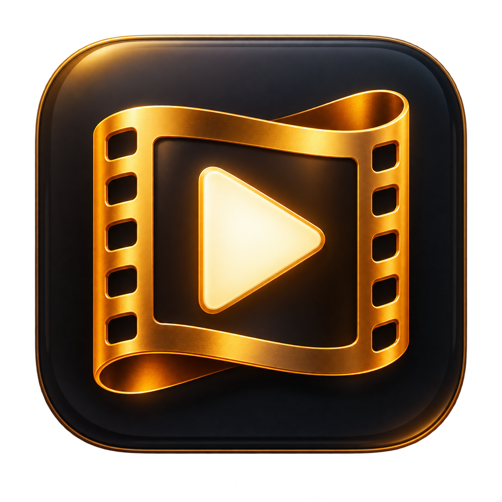

<p align="center"></p>

# Cinema

**Os teus filmes. A tua sala. No Mac, iPhone e iPad.**

Projeto comunitário de Patrício Brito ([Pathink1973](https://github.com/Pathink1973)), criado com ajuda do Codex. Transforma as tuas pastas de vídeos numa biblioteca pessoal com capas, fichas de filmes, favoritos e coleções. Código aberto para aprender, adaptar e criar a tua própria versão.

**Desktop:** aplicação nativa para macOS, em SwiftUI. **Mobile:** web app que o Mac disponibiliza na mesma rede Wi-Fi; abre no Safari e reproduz os vídeos no VLC instalado no iPhone/iPad. Não é uma aplicação da App Store nem um serviço na cloud.

## O que podes fazer

- Adicionar pastas, subpastas e discos externos; detetar novos vídeos automaticamente.
- Organizar MKV, MP4, AVI, MOV, M4V e WebM; associar legendas SRT.
- Obter capas, sinopses, elenco e realização através do TMDB, com o teu próprio token.
- Navegar num início cinematográfico, pesquisar e criar favoritos e coleções.
- Identificar filmes manualmente quando a correspondência automática é ambígua.
- Excluir vídeos da biblioteca sem apagar os ficheiros.
- Consultar a mesma biblioteca no iPhone/iPad através de um QR code.
- Preparar uma cópia temporária com legendas incluídas e verificadas, acompanhar o progresso e abrir ou guardar no VLC.

## Começar

Precisas de **macOS 14 ou superior**, **Swift 6 ou superior**, VLC e, para a preparação mobile, FFmpeg/FFprobe. O pacote não tem dependências Swift externas. A compilação usa a arquitetura do teu Mac; não gera automaticamente uma aplicação Universal.

```sh
git clone https://github.com/Pathink1973/cinema.git
cd cinema
./scripts/check-environment.sh
swift test
./scripts/build-app.sh
```

O resultado fica em `dist/Cinema.app`. Arrasta-o para Aplicações, abre, adiciona uma pasta e configura opcionalmente o token TMDB. A distribuição inicial é **por código-fonte**: não há um instalador notarizado. O Codex é opcional; podes compilar sem ele.

**Guias completos:**

| Quero… | Guia |
| --- | --- |
| Instalar e compilar no Mac | [Instalação](docs/INSTALACAO.md) |
| Usar a biblioteca, legendas e metadados | [Utilização](docs/USO.md) |
| Configurar o iPhone/iPad e ver na TV | [Mobile e TV](docs/MOBILE.md) |
| Criar a minha versão com o Codex | [Guia Codex e prompts](docs/CODEX.md) |
| Conhecer a estrutura do código | [Arquitetura](docs/ARQUITETURA.md) |
| Resolver problemas | [Problemas frequentes](docs/PROBLEMAS.md) |
| Contribuir | [Contribuições](CONTRIBUTING.md) |

## Como funciona

```text
Pastas de vídeos → Cinema no Mac → VLC no Mac
                         │
                         └─ HTTP na rede local → Safari no iPhone/iPad → VLC
```

O Mac tem de ficar acordado, com a aplicação e o catálogo abertos e o disco ligado. O catálogo só funciona na rede local. Quem tiver o URL nessa rede pode consultar a biblioteca e alterar favoritos/coleções; a ligação usa HTTP, sem encriptação. Não abras portas no router nem publiques o URL do catálogo. Consulta [privacidade e segurança](SECURITY.md).

Os originais não são alterados. A preparação mobile cria cópias temporárias que podem ocupar aproximadamente o tamanho de cada filme. Nesta versão, a partilha mobile exige uma legenda externa válida ou uma faixa interna. O VLC pode exigir que atives a faixa de legendas nas suas preferências.

## Personalizar e contribuir

Faz um **fork**, muda o visual, acrescenta funcionalidades e partilha melhorias por pull request. O [guia Codex](docs/CODEX.md) inclui prompts para instalar, personalizar o desktop e alterar a interface mobile. O ficheiro [AGENTS.md](AGENTS.md) explica o projeto aos agentes de programação.

Não precisas de uma chave OpenAI para o Cinema: a aplicação não chama a API da OpenAI. Para trabalhar com o Codex, usa o teu próprio acesso ao produto. Para metadados e capas, cada pessoa configura a sua conta TMDB.

## Créditos e licença

Código original sob [licença MIT](LICENSE). A licença permite usar, modificar e redistribuir, mantendo o aviso de licença. Filmes, legendas, dados e marcas de terceiros não são licenciados por este repositório. Usa conteúdos que tenhas direito a utilizar.

Referências visuais, sem código reutilizado: [apple-tv-launcher](https://github.com/Fardin7798/apple-tv-launcher) e [hume-launcher](https://github.com/petrobot-admin/hume-launcher).

Metadados e imagens: [TMDB](https://www.themoviedb.org). This product uses the TMDB API but is not endorsed or certified by TMDB. Os termos do TMDB aplicam-se separadamente; consulta a [documentação oficial](https://developer.themoviedb.org/docs/faq), incluindo utilização comercial.

[VLC](https://www.videolan.org/vlc/) e [FFmpeg](https://ffmpeg.org/) são programas externos, não incluídos. Consulta [NOTICE](NOTICE) para os recursos e serviços de terceiros.

---

**English:** Cinema is an open-source macOS movie library with an iPhone/iPad web companion on your local network. Requires macOS 14+, Swift 6+, VLC, and FFmpeg for mobile subtitle preparation. Build with `./scripts/build-app.sh`; output: `dist/Cinema.app`. The mobile interface browses your Mac library and opens VLC; it is not an App Store app or a public streaming service. Portuguese documentation and Codex customization prompts are linked above. MIT license applies to original project code, not third-party media or services.
